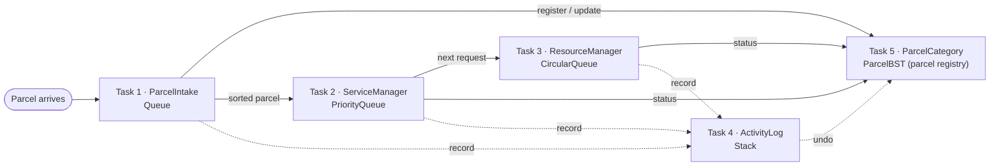

# SCPCDMS — Smart Campus Parcel Collection and Delivery Management System

A C++ console prototype that registers, sorts, routes, assigns and tracks parcels for APU students and staff, built on five data structures the team implements from scratch.

**APU · CT077-3-2-DSTR Data Structures · Assignment 2 (Lab Evaluation Work #2)**

- **Assessment:** group development + individual evaluation
- **Working period:** Week 10 – Week 14
- **Language:** C++20 (Visual Studio 2026)
- **Marks:** 30
- **Learning outcome:** CLO3 — write solutions using various data structures and algorithms (P5, PLO3)

> **Status: skeleton.** The shared records in `Models.h` are defined. The data structures in `ds/` and the task modules in `modules/` are empty stubs. Tick the checklists under [Modules](#modules) as features land.

## Build and run

**Visual Studio 2026** (toolset v145)

1. Open `SCPCDMS.slnx`.
2. Select **Debug | x64**.
3. Press **Ctrl+F5** to build and run.

On Visual Studio 2022, open `SCPCDMS.vcxproj` and retarget to toolset v143 when prompted (or under *Project → Properties → General → Platform Toolset*).

**Command line.** MSBuild, from a *Developer PowerShell for VS*:

```powershell
msbuild SCPCDMS.vcxproj -p:Configuration=Debug -p:Platform=x64
.\x64\Debug\SCPCDMS.exe
```

Or g++ (MSYS2 / Git Bash):

```bash
g++ -std=c++20 -Wall -Wextra -o scpcdms *.cpp ds/*.cpp modules/*.cpp
./scpcdms
```

When you add a `.cpp` file, add it to the Visual Studio project too (right-click the folder → *Add → Existing Item*), or Visual Studio will not compile it.

## Project structure

```text
SCPCDMS/
├── SCPCDMS.cpp               main(): top-level menu; builds the five modules and wires them together
├── Models.h                  shared records (Parcel, ServiceRequest, Resource, Activity), enums, toString()
├── Utils.h / Utils.cpp       shared helpers: input validation, date/time, ID generation
├── ds/                       the five compulsory data structures, written from scratch
│   ├── Queue.h               linked-list FIFO queue             → Task 1
│   ├── PriorityQueue.h       binary-heap priority queue         → Task 2
│   ├── CircularQueue.h       fixed-capacity circular queue      → Task 3
│   ├── Stack.h               linked-list LIFO stack             → Task 4
│   ├── ParcelBST.h           binary search tree on Parcel ID    → Task 5
│   └── ParcelBST.cpp
├── modules/                  one class per task, each built on its data structure
│   ├── ParcelIntake.h/.cpp       Task 1 · Parcel Intake, Sorting and Processing
│   ├── ServiceManager.h/.cpp     Task 2 · Parcel Service and Collection Management
│   ├── ResourceManager.h/.cpp    Task 3 · Collection Counter and Delivery Resource Management
│   ├── ActivityLog.h/.cpp        Task 4 · Parcel Activity and Record Management
│   └── ParcelCategory.h/.cpp     Task 5 · Parcel Category Organisation
├── SCPCDMS.slnx              Visual Studio solution
├── SCPCDMS.vcxproj           project file (C++20, toolset v145)
├── SCPCDMS.vcxproj.filters   Solution Explorer folders
└── README.md
```

- Every header opens with a short comment: what it is for, which task or data structure it belongs to, and what it works with. Read it before changing the file.
- `Queue`, `PriorityQueue`, `CircularQueue` and `Stack` are templates, so their code lives in the header; only `ParcelBST` has a `.cpp`.
- Dependencies point one way: `modules/` → `ds/` → `Models.h`. Nothing in `ds/` includes a module.
- `docs/` is gitignored, so anything you put there stays on your machine.

## Team

Each member owns one data structure in `ds/`; the last column is the task module built on it.

| Member | Name | Student ID | Data structure | Used by |
|---|---|---|---|---|
| A | *TBC* | *TBC* | `ds/Queue.h` | Task 1 — `ParcelIntake` |
| B | *TBC* | *TBC* | `ds/PriorityQueue.h` | Task 2 — `ServiceManager` |
| C | *TBC* | *TBC* | `ds/CircularQueue.h` | Task 3 — `ResourceManager` |
| D | *TBC* | *TBC* | `ds/Stack.h` | Task 4 — `ActivityLog` |
| E | *TBC* | *TBC* | `ds/ParcelBST.h` / `.cpp` | Task 5 — `ParcelCategory` |

## Data structure selection

All five structures are compulsory, but the brief leaves it to the team to decide which task uses which, and each one has to solve a real requirement rather than just be demonstrated. The brief's background lists the system's jobs in the same order as the tasks, and each job suits one structure:

| Task | What it needs | Structure | Why it fits |
|---|---|---|---|
| 1 · Parcel intake | Hold arrived parcels until they are sorted, oldest first | **Queue** (linked list) | First in, first out matches arrival order. Enqueue and dequeue are O(1), and a linked list never fills up at peak times. |
| 2 · Service requests | Handle the most urgent request next, not the oldest | **Priority Queue** (binary heap) | `top()` is O(1) and `push()` / `pop()` are O(log n), cheaper than keeping a sorted list. |
| 3 · Counters and couriers | Share work across a fixed pool of resources, over and over | **Circular Queue** (fixed array) | Rotating through the pool gives round-robin allocation for free. The pool size is known, so a fixed array wastes nothing. |
| 4 · Activity history | Show the latest activity first and undo the latest | **Stack** (linked list) | Last in, first out puts the newest activity on top, which is what both the display and undo need. Push and pop are O(1). |
| 5 · Parcel organisation | Insert, find, list, update and delete records by key | **Binary Search Tree** on Parcel ID | Search, insert and delete are O(h). An in-order traversal lists parcels sorted by ID without a separate sort. |

## How the modules work together

The brief asks for one integrated program, not five separate ones. Each parcel passes through every module:

| # | Step | Module | What happens in the data structure |
|---|---|---|---|
| 1 | Parcel arrives | Task 1 | Staff enter its details; the input is validated |
| 2 | Parcel is registered | Task 1 → Task 5 | `ParcelBST.insert()`, then `Queue.enqueue(parcelId)` |
| 3 | Parcel is sorted for its next action | Task 1 | `Queue.dequeue()`, earliest arrival first |
| 4 | Service request created (if needed) | Task 2 | `PriorityQueue.push()` |
| 5 | Next request chosen | Task 2 | `PriorityQueue.top()`: highest priority, earliest on a tie |
| 6 | Counter or courier assigned | Task 3 | `CircularQueue` rotates to the next available resource of the right type |
| 7 | Parcel or service processed | Task 2, Task 3 | Request `Processing`, resource `Occupied` |
| 8 | Statuses updated | Task 2, Task 5 | `ParcelBST.update()`; the finished request leaves the heap and the resource is released |
| 9 | Activity recorded | Task 4 | `Stack.push(activity)` after every step above |
| 10 | Parcel closed: collected, delivered, returned, cancelled, on hold or missing | all | Final status is saved in the BST; the latest step can still be undone from the stack |



## Modules

### Task 1 · Parcel Intake, Sorting and Processing

`modules/ParcelIntake` · **Queue**. Receives parcels at the delivery centre, registers them and routes each one to its next action.

**Record:** Parcel ID · Recipient ID · Recipient Name · Delivery Company · Parcel Type · Arrival Date/Time · Parcel Status\
**Types:** Standard, Large, Fragile, Document, Special-Handling\
**Statuses:** Received, Pending, Processing, Ready for Collection, Out for Delivery, Collected, Delivered\*, Returned, On Hold\*, Missing, Cancelled (\* see [Notes on the brief](#notes-on-the-brief))

- [ ] Register a parcel: unique Parcel ID, recipient and courier details, type, arrival time and initial status; reject incomplete or duplicate entries
- [ ] Display, search and view parcel records with their current status
- [ ] Sort incoming parcels by next action (collection, campus delivery, special handling, return to sender, or hold for investigation) and update the status
- [ ] Update or remove a record when things change (status, collection, delivery, return, cancellation); block invalid changes
- [ ] Exceptions: duplicate ID · invalid recipient · missing details · parcel reported missing · parcel not found · parcel already completed · nothing waiting to process

**Outputs:** registration record · pending list · parcel selected for processing · updated status · processed, completed, missing and returned records

### Task 2 · Parcel Service and Collection Management

`modules/ServiceManager` · **Priority Queue**. Tracks the services a registered parcel still needs, from request to completion, cancellation or return.

**Record:** Request ID · Parcel ID · Recipient ID · Recipient Name · Service Type · Request Date/Time · Request Status\
**Service types:** Recipient Collection, Campus Delivery, Special Handling, Return to Sender, Re-delivery\
**Statuses:** Pending, Processing, Completed, Cancelled, Returned

- [ ] Create a request for a registered parcel: unique Request ID, existing Parcel ID, initial status; reject invalid or duplicate requests
- [ ] List active requests waiting for action; add, view and process them, and remove them once completed or cancelled
- [ ] Choose the next request by the team's [priority rule](#rules-the-team-must-define)
- [ ] Process a request: record completion, cancellation or return, update the parcel, and never process a closed request again
- [ ] Exceptions: no active requests · invalid Request or Parcel ID · cancelled request · wrong recipient or collection details · equal priority (tie) · request already completed · invalid service operation

**Outputs:** active requests · selected request · next request to process · updated status · completed, cancelled and returned requests

### Task 3 · Collection Counter and Delivery Resource Management

`modules/ResourceManager` · **Circular Queue**. Keeps track of counters and delivery staff, and assigns parcels or requests to them.

**Record:** Resource ID · Resource Type · Location (if any) · Current Status · Current Parcel/Request · Transactions Handled\
**Types:** Collection Counter, Delivery Desk, Special-Handling Counter, Delivery Personnel\
**Statuses:** Available, Occupied, Unavailable, Maintenance

- [ ] Register and maintain resources, each with a unique ID, a type and a status
- [ ] Show live availability (available, occupied, unavailable) with each resource's current assignment
- [ ] Assign a parcel or request to a suitable available resource by the team's [allocation rule](#rules-the-team-must-define); update both sides
- [ ] Change a resource's status while keeping its assignment consistent
- [ ] Exceptions: every resource busy · no suitable resource · resource becomes unavailable mid-job · invalid Resource ID · unavailable resource selected · duplicate active assignment · invalid release or update

**Outputs:** resource list · current status · parcel-to-resource assignment · resource handling each request · utilisation per resource

### Task 4 · Parcel Activity and Record Management

`modules/ActivityLog` · **Stack**. Keeps the history of what happened to each parcel, and lets staff undo a recent step where that is allowed.

**Record:** Activity ID · Parcel ID · Request ID (if any) · Activity Type · Date/Time · Previous Status · New Status · Staff/User ID (if any)\
**Types:** Parcel Registration, Parcel Update, Service Request Creation, Resource Assignment, Status Change, Collection Confirmation, Cancellation, Return Processing

- [ ] Record every important activity with enough detail to identify the parcel, the activity and when it happened
- [ ] Show recent activities, and one parcel's full history in the order it happened
- [ ] Review a parcel's past activities: sequence, previous status, latest activity, related request or resource
- [ ] Undo an eligible recent activity: check it is allowed, restore the previous state, update the parcel, request and resource
- [ ] Exceptions: no history · invalid Parcel ID · activity cannot be undone · already undone · invalid selection · undo would leave an invalid parcel status

**Outputs:** activity records · recent history · activity trace for one parcel · current parcel status · result of an undo

### Task 5 · Parcel Category Organisation

`modules/ParcelCategory` · **Binary Search Tree**. Organises parcel records in a tree on a chosen key so they can be inserted, found, listed, updated and removed efficiently.

**Record:** Parcel ID · Recipient ID · Recipient Name · Delivery Company · Parcel Category · Service Type · Parcel Status · Arrival Date/Time\
**Key:** Parcel ID (see [rules](#rules-the-team-must-define))

- [ ] Create and maintain the tree of parcel records
- [ ] Insert a record after validating it; reject a duplicate key
- [ ] Search for a parcel or key; show a clear message when it does not exist
- [ ] Display records with a traversal chosen for the purpose, and justify the choice
- [ ] Update or remove a record while keeping the BST ordering
- [ ] Exceptions: empty tree · duplicate key · parcel not found · invalid ID or key · deleting or updating a record that does not exist · invalid details · a deletion that reshapes the tree (a node with two children, or the root)

**Outputs:** tree structure · inserted record · search result · traversal listing · updated record · deletion result · messages for failed operations

## Rules the team must define

The brief leaves these rules to the team and expects each to be justified. The values below are proposals: agree on them before implementing, then keep this table in step with the code.

| Rule | Proposal | Justification |
|---|---|---|
| **Task 1:** routing an incoming parcel | Default by type, which staff can override: Standard / Document → Recipient Collection; Large → Campus Delivery; Fragile / Special-Handling → Special Handling. Recipient cannot be identified → Return to Sender. Anything needing investigation (damage, details that do not match) → On Hold | The type decides how a parcel can be handed over safely, and problem parcels are held instead of routed. |
| **Task 2:** next request to handle | Special Handling > Re-delivery > Campus Delivery > Recipient Collection > Return to Sender. On a tie, the earlier request wins (`sequenceNo`) | At-risk items go first, then recipients who already missed a delivery, then time-bound deliveries. Returns have no one waiting. The tie-break makes equal priorities first-come, first-served. |
| **Task 3:** choosing a resource | The service type decides the resource type: Collection → Collection Counter, Campus Delivery / Re-delivery → Delivery Personnel, Special Handling → Special-Handling Counter, Return → Delivery Desk. Take the next *Available* one in circular order. One full rotation with no match means "no suitable resource" | Round-robin spreads transactions evenly, and each assignment visits every resource at most once (O(n)). |
| **Task 4:** what can be undone | Only the most recent activity that has not been reversed. Collection Confirmation and Return Processing are final. Undo restores the previous status and frees or reverts the linked request or resource. The activity stays in the history, marked reversed | Undoing an older activity could break the ones recorded after it; the stack's LIFO order prevents that. |
| **Task 5:** key and traversals | Key: Parcel ID. In-order for listings (sorted by ID); pre-order, indented by depth, to show the tree's structure; post-order to free every node in the destructor | Parcel IDs are unique, so every search follows a single path. In-order gives sorted output, pre-order prints each parent before its children, and post-order frees children before their parent. |

## Design notes

- **Keep one copy of each record.** Parcels live only in the BST. Queues, requests, resources and activities store the Parcel ID and look the parcel up. A common BST delete copies the successor into the deleted node, so a stored pointer could quietly end up pointing at a different parcel.
- **Heaps are not stable.** Two requests with the same priority can come out in either order, so the comparison has to fall back to `sequenceNo` (creation order).
- **Cancelling a waiting request.** A heap only removes its top. Either remove by index and re-heapify, or mark the request cancelled and skip it when it reaches the top (lazy deletion). Pick one and explain it.
- **Sequential IDs skew the BST.** Inserting P0001, P0002, … in order builds a tree with one long branch, so search becomes O(n). Say so in the report; AVL rotations or rebuilding a balanced tree from the in-order list fix it.
- **Rule of Three.** Every structure owns raw memory, so each needs a destructor, a copy constructor and copy assignment (or `= delete` the copy operations). Without them, copying a structure frees the same memory twice.
- **Fixed capacity.** The circular queue cannot grow, so adding a resource when it is full must print an error, not overwrite data.
- **Visual Studio's SDL checks** turn deprecation warnings (C4996) into errors, so `localtime`, `strcpy` and `scanf` will not compile. Use `localtime_s` or `<chrono>`, and `std::string` instead of C strings.

## Implementation rules

- Write every data structure yourself. The brief bans `std::vector`, `std::list`, `std::stack`, `std::queue`, `std::priority_queue` and `std::deque`, and any other container used to dodge the exercise, so avoid `std::map`, `std::set`, `std::unordered_*` and `std::array` too.
- Fine to use: `<iostream>`, `<iomanip>`, `<string>`, `<sstream>`, `<limits>`, `<ctime>`, `<chrono>`.
- The code is marked on meaningful names, modular classes and functions, comments, input validation and error handling, correctness, and reasonable efficiency.
- Every menu option must survive bad input (letters where a number is expected, empty fields, unknown IDs) and print a clear message instead of crashing.
- Work on your own branch (`feat/<name>`) and merge into `main` through a pull request.

## Notes on the brief

- The brief introduces the system tasks as four compulsory modules, then lists and specifies five. All five are built.
- `Delivered` and `On Hold` are missing from Task 1's status list, but the brief's own workflow ends with parcels being delivered or put on hold, so both are in `ParcelStatus`.
- Task 5's *Parcel Category* is the same field as Task 1's *Parcel Type* (`Parcel::type` in `Models.h`).
- Activities also store a Resource ID (not in the brief's list), so undoing a Resource Assignment can free the right resource.
